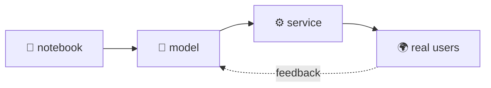

<!-- ░░ header · tap it, it's a door ░░ -->
<a href="https://salahuddinbayassi.vercel.app/">
  
</a>

<div align="center">

<sub><code>latent · dim 768</code> &nbsp;·&nbsp; <code>denoising · step 03 / 24</code> &nbsp;·&nbsp; <code>Istanbul · UTC+3</code></sub>

<br/><br/>


<br/><br/>

<i>Most models die in a notebook.<br/>I build everything around them that lets them survive real traffic and real people.</i>

<br/><br/>

<a href="https://salahuddinbayassi.vercel.app/"></a>
<a href="https://linkedin.com/in/salahuddin-bayassi"></a>
<a href="mailto:salahuddinbayassi@gmail.com"></a>

</div>

<br/>

### ⌬ `model.summary()`

```text
Model: "salahuddin"
─────────────────────────────────────────────────────────────────────────────
 Layer (type)            Does                          Weights
═════════════════════════════════════════════════════════════════════════════
 L1 · LLMSystems         agents · RAG · self-checks    LangGraph · pgvector
 L2 · DeepLearning       train → serve → scale         PyTorch · FastAPI · Celery
 L3 · ComputerVision     finds things in photo/video   YOLO · EfficientNet · OpenCV
 L4 · Software           the app around the model      Next.js · Django · Postgres
 L5 · Data               experiments → decisions       SQL · pandas · A/B tests
═════════════════════════════════════════════════════════════════════════════
 Prev. deployed: Gateworx (camera AI)   Trainable params: still growing
 Full render: salahuddinbayassi.vercel.app
```

### ⟡ `training.log`

```diff
  epochs, newest first

+ ep.now   loss.backward() on new open-source AI work ........ stay tuned
  ep.prev  shipped camera models for theft, fire & crowds ...... @ Gateworx
! status   open to AI engineering roles & freelance work
```

### ◈ fig. 01 — from notebook to production



<sub>↳ a static sketch. the <a href="https://salahuddinbayassi.vercel.app/">live version</a> moves.</sub>

### ⬡ stack

<div align="center">


<br/>


</div>

<br/>

<div align="center">

<sub>this page is the source code.&nbsp; <a href="https://salahuddinbayassi.vercel.app/"><b>the render lives here ↗</b></a></sub>
<br/>
<sub><code>salahuddin@arch-linux:~$ exit</code> &nbsp;·&nbsp; <code>denoising · step 24 / 24</code></sub>

</div>

<a href="https://salahuddinbayassi.vercel.app/">
  
</a>
